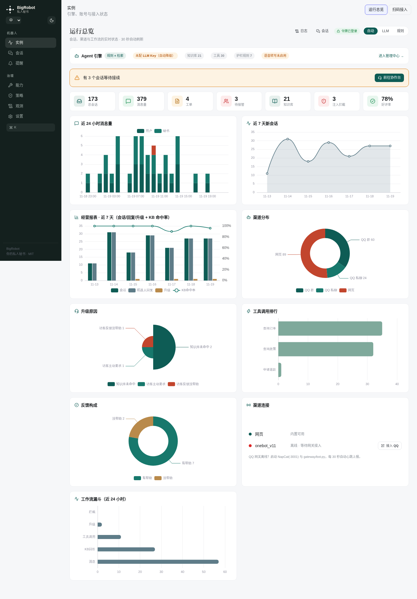
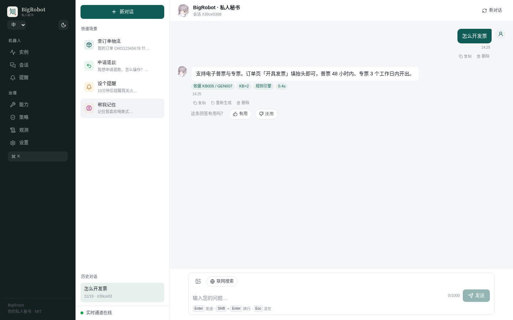

# BigRobot

**A bot platform that takes over the account.** One process, many model APIs, many protocol
endpoints — running in group chats, DMs and on the web. The model picks; the harness executes,
validates, gates and records.

[中文](README.md) · [Architecture](docs/ARCHITECTURE.md) · [Deploy](docs/DEPLOY.md) · [Comparison](docs/COMPARISON.md) · [Changelog](CHANGELOG.md) · [Roadmap](ROADMAP.md)

<p align="center">
  <video src="docs/media/demo.mp4" width="860" autoplay muted loop playsinline aria-label="BigRobot: console, chat, tool execution, audit"></video>
</p>

---

## What it is

Not a chat box wrapped around an API key. BigRobot is an **agent harness**: a tool-calling
loop, graded action permissions, hash-chain audit, hybrid retrieval and multi-endpoint model
fallback — all in one process, all managed from one console.

Model, channels, knowledge base, persona and action policy are **runtime configuration**:
edit in the console, effective immediately, no restart, no code change.

## 30 seconds

Docker is the recommended path (the only external dependency is a model API):

```bash
docker run -d --name bigrobot -p 8010:8010 \
  -e ADMIN_TOKEN=change-me -e CHANNEL_TOKEN=change-me-too \
  -v bigrobot-data:/app/.tmp bigrobot
```

Open <http://127.0.0.1:8010>, sign in with `ADMIN_TOKEN`. First start offers a wizard for the
model key, an optional protocol endpoint and a self-check.

From source (Python 3.12+):

```bash
pip install -e . && bigrobot init && bigrobot run
```

Full deployment (source / image / reverse proxy / troubleshooting): [docs/DEPLOY.md](docs/DEPLOY.md).

## What it does

| | |
|---|---|
| **Real execution** | 55 built-in tools: the model only picks; the loop executes, validates params and detects repeated actions. |
| **Graded action permission** | Every write carries an L0/L1/L2 risk level and a T0–T3 subject tier; destructive actions require human approval — no silent escalation. |
| **Hash-chain audit** | Who asked, what ran, what changed — tamper-evident and verifiable from the console. |
| **Hybrid retrieval** | SQLite FTS5 BM25 fused with optional `sqlite-vec` vectors via RRF; degrades cleanly to keyword search without an embedding model. |
| **Multi-endpoint model fallback** | Endpoint racing + cooldown breaker, plus content-level fallback: retry with another model when a reply is empty or truncated. |
| **Protocol-native** | OneBot v11 gateway with group throttling, bot-vs-bot loop guard, sticker learning, voice in/out. |
| **Never mute without a key** | Rules and retrieval keep working; group chats reply in explicit rule mode instead of going silent. |

| Area | Included |
|---|---|
| **Channels** | QQ groups/DMs (OneBot v11), embedded web chat, WebSocket operator desk; WeCom / Official Account are adapter skeletons |
| **Agent** | Multi-step ReAct, native function calling with JSON fallback, per-run token/wall-clock budget, cancellable |
| **Knowledge** | Markdown / text / PDF / DOCX / XLSX import, trial recall, export, per-entry edit |
| **Memory & reminders** | Long-term preferences, session notes; Chinese natural time (`十分钟后`, `每天八点`) and cron rules |
| **Persona** | 6 categories, 15 presets, structured role cards with drift guard, import/export |
| **Ops** | Prometheus metrics, request correlation IDs, `/healthz`, `/readyz`, multi-stage image, non-root |

## What it connects to

- **Models** — any OpenAI-compatible endpoint; endpoint racing so one bad vendor doesn't stall the site.
- **Protocol endpoints** — OneBot v11 (NapCat and friends). The endpoint owns login and protocol;
  BigRobot owns the brain and the governance.
- **External tools** — an MCP server exposes capabilities; business systems plug in over HTTP tools.
- **Web** — embedded chat and operator desk share the same sessions and audit trail.

## Console

One login, one interface: sessions, tools, action approvals, knowledge base, persona, models,
channels, audit, logs. `/actions` is the single place pending approvals live — the place you
approve is the place they are raised.

> 2.0 is merging 28 pages into 7 (instances / sessions / capabilities / policy / observability /
> settings / reminders). Screenshots below are 1.x and only illustrate scope.

<table>
<tr>
<td width="50%"><br><sub><b>Overview</b></sub></td>
<td width="50%"><br><sub><b>Web chat</b></sub></td>
</tr>
</table>

## CLI

```
bigrobot init      # create .env, generate tokens, init DB
bigrobot run       # start the server (--gateway also starts the protocol gateway)
bigrobot doctor    # check deps, tokens, port, DB, frontend, service health
bigrobot status    # current config and live service state
bigrobot version   # version and paths
```

When something is wrong, run `bigrobot doctor` first: it reports the *actual* state — who holds
the port, whether the model key is really configured.

## Configuration

Three layers: **code defaults → env vars → database**. The console writes the database layer,
so changes apply immediately. All keys in [`.env.example`](.env.example). Since 2.0 every env
var uses the `BIGROBOT_*` prefix; legacy `CS_AGENT_*` / `ZHIKE_*` are mapped automatically.

## Verify it works

```bash
pytest tests -q                                   # 976 passed
ruff check core executor gateway scripts tests    # 0 errors
python scripts/harness_all.py                     # offline regression
cd frontend && npm test && npm run build          # frontend
python scripts/e2e_check.py --base-url <isolated instance>
```

> `e2e_check.py` writes sessions, messages and tickets, then cleans up. **Isolated instances only.**

## Honest limits

- **External services are external.** Models, search, protocol delivery and voice depend on the
  network and vendor availability. "Configured" in the console does not mean "reachable now".
- **Reminder time zones** depend on the entry point and server TZ — verify in the target env.
- **Budgets are checked before and after** each call, not a hard per-request cap.
- **WeCom / Official Account** are adapter skeletons, not production integrations.
- **File / shell / process** operations need explicit policy and approval, off by default.

## Docs

One topic per document, no duplication:

| Doc | Sole responsibility |
|---|---|
| [docs/ARCHITECTURE.md](docs/ARCHITECTURE.md) | Code map: modules, data flow, invariants, extension points |
| [docs/DEPLOY.md](docs/DEPLOY.md) | Deployment and protocol endpoint setup |
| [docs/COMPARISON.md](docs/COMPARISON.md) | How it differs from peers, with evidence |
| [ROADMAP.md](ROADMAP.md) | What we will and will not do |
| [CHANGELOG.md](CHANGELOG.md) | Per-version changes |
| [CONTRIBUTING.md](CONTRIBUTING.md) · [SECURITY.md](SECURITY.md) | Development and private reporting |

## License

[MIT](LICENSE). NapCat is an independent unofficial protocol implementation — check its license
and the platform rules before commercial use.
