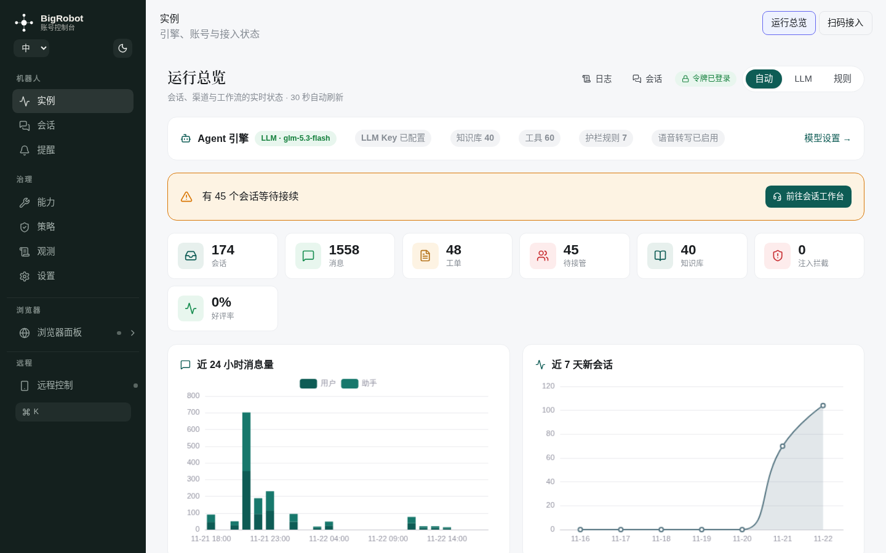
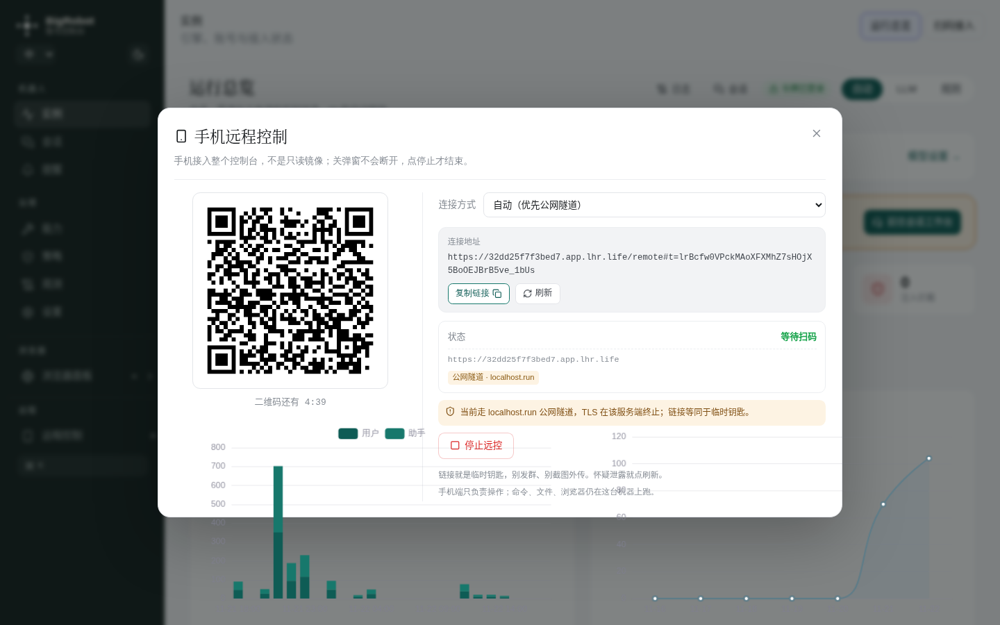
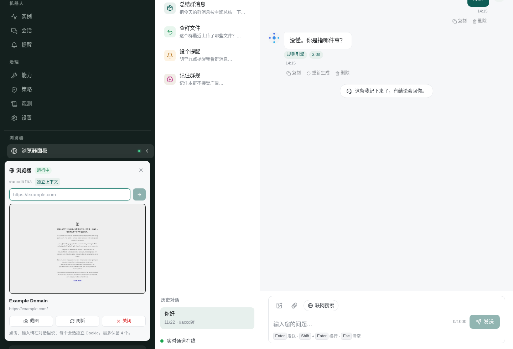

# BigRobot

[中文](README.zh.md) · **English**

BigRobot turns a chat account you already own into a self-hosted AI workspace. It keeps the account at the centre: real groups, members, files and history, with an assistant that can act only within the permissions you set.

## Screens

**Console overview.** Accounts, sessions, knowledge, tools and channel health on one screen. The sidebar expands into the browser panel and phone remote control.



**Phone remote control.** The desktop issues a one-time QR; the phone joins the full console, not a read-only mirror.



<sub>UI reference only; the QR code in this screenshot has expired. Generate a fresh one on the desktop.</sub>

**Per-session browser.** Each session gets its own cookies and localStorage; the sidebar shows the page, screenshots and refresh controls.



## Why it starts with the account

Most bots wait for messages. BigRobot starts by taking over an existing account and showing what is actually in it. QQ is the first channel because QQ has no usable backend: you log in and see nothing. Here you see the groups, the members, the files and the history, then put an agent on top.

## Download

Windows single-file build: `releases/2.0.2/bigrobot-2.0.2-win64.exe` (no Python required). GitHub Releases carries the same file plus `SHA256SUMS.txt`, and Gitee has a Release too. GitCode's Release only exposes source archives, so the installer lives in the repository's `releases/2.0.2/` directory.

The binary is unsigned, so Windows may show SmartScreen. First run creates `bigrobot-data/` in the user data directory. Checksums are in `releases/2.0.2/SHA256SUMS.txt`.

## What it does

- **Account takeover** — start the protocol, scan a QR code, keep it alive with a watchdog and restart backoff.
- **Visibility** — group and direct-message history stored locally, member lists with roles, group files, notices and friends.
- **Actions** — send text, images, voice and files; recall, mute, kick, edit a card, publish a notice.
- **Voice** — audio is kept with the message, transcoded, transcribed, and written back into the transcript.
- **Agent** — tool calling with risk levels, approvals and an audit trail; reminders and future tasks.
- **Knowledge** — multi-collection retrieval, document ingestion and persona-scoped packs.
- **Local models** — download a recommended sub-2B model, run it offline, and switch with one click; prompts stay on the machine.
- **Extensions** — declarative HTTP packs and an MCP stdio client; installed tools join the same agent registry.
- **Console** — one account dialog, one session drawer; the UI renders from channel capabilities, not platform names.

## Design notes

**Capabilities, not platform names.** `core/adapters_registry.py` declares what a channel can do. Adding a platform means adding a declaration, not editing the UI.

**Nothing pretends to work.** No protocol connection returns 409, unconfigured transcription returns 503, unsupported audio returns 422. A failed step is reported as failed.

**Migrations are additive.** Schema changes add nullable columns first and backfill only what can be known. Old rows keep an empty account rather than a guessed one.

## Start

```bash
pip install -r requirements.txt
ADMIN_TOKEN=change-me python -m uvicorn core.main:app --port 8010
```

Open `http://127.0.0.1:8010`. QQ needs a local protocol implementation (NapCat); the account dialog walks through deploy → start → scan. Details in [Deployment](docs/DEPLOY.md).

## Check

```bash
python scripts/full_check.py        # everything, a few minutes
python scripts/full_check.py --fast # skip the test suite
```

Backend tests, ruff, mypy, frontend lint/tests/build, route count and harness checks run in one pass, and the report is printed even when a check fails.

## Structure

```
core/      API, storage, agent loop, channel adapters
gateway/   bridge to the chat protocol
executor/  sandboxed action runner
frontend/  console (React)
docs/      current docs, with Chinese translations in docs/zh
```

## Docs

[Deployment](docs/DEPLOY.md) · [Architecture](docs/ARCHITECTURE.md) · [Releasing](docs/RELEASING.md) · [Route audit](docs/route-audit.md) · [Persona eval](docs/PERSONA-EVAL.md) · [Extensions & MCP](docs/extensions.md) · [Knowledge base](docs/knowledge-base.md) · [Future tasks](docs/future-tasks.md) · [Channel events](docs/channel-events.md) · [Multi-account](docs/multi-account.md) · [Persona capabilities](docs/persona-capabilities.md) · [Local models](docs/LOCAL-MODELS.md) · [All docs](docs/README.md)

## Status

Working: QQ account takeover, history, members, files, voice transcription, tool calling with approvals.

Not yet: a second full channel implementation, and an end-to-end run against a live account in CI.

## License

MIT — see [LICENSE](LICENSE).
