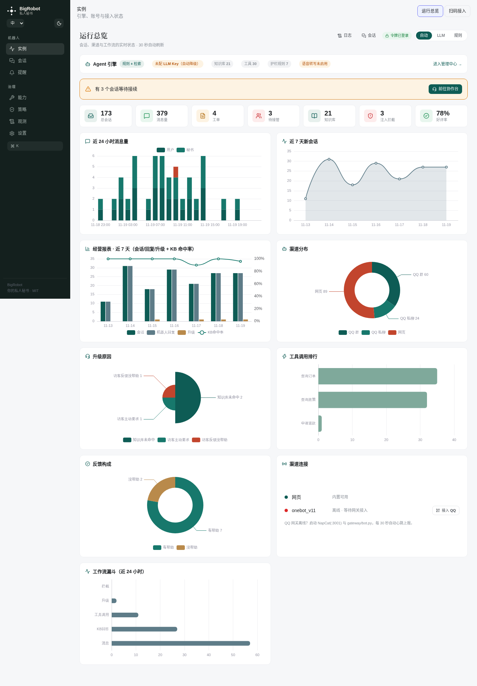
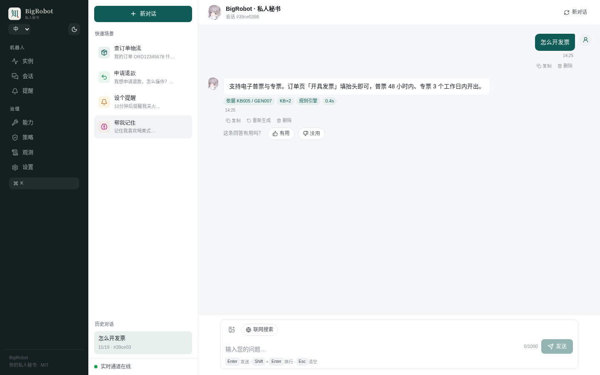
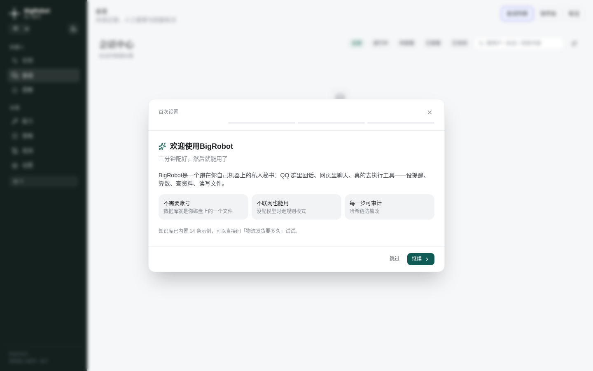
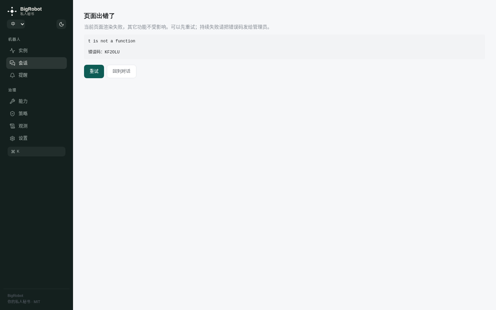

# BigRobot

**接管账号的机器人平台。** 一个进程接多家模型 API、多个协议端，同时跑在群聊、私聊与网页上；
模型负责选，引擎负责执行、校验、审批与留痕。

[English](README.en.md) · [架构](docs/ARCHITECTURE.md) · [部署](docs/DEPLOY.md) · [对比](docs/COMPARISON.md) · [更新日志](CHANGELOG.md) · [路线图](ROADMAP.md)

<p align="center">
  
</p>

---

## 它是什么

不是给 API Key 套一层聊天框。BigRobot 是 **agent harness**：工具调用循环、分级动作权限、
哈希链审计、混合检索、多端点模型备援，全部在一个进程里，由控制台统一管理。

模型、渠道、知识库、人设、动作权限都是**运行时配置**，改完即生效，不用重启、不用改代码。

## 30 秒上手

Docker 是推荐方式（外部依赖只有模型 API）：

```bash
docker run -d --name bigrobot -p 8010:8010 \
  -e ADMIN_TOKEN=change-me -e CHANNEL_TOKEN=change-me-too \
  -v bigrobot-data:/app/.tmp bigrobot
```

打开 <http://127.0.0.1:8010>，用 `ADMIN_TOKEN` 登录，首次启动有向导带你配模型 Key、
可选接入协议端、跑一次自检。

也可以直接从源码跑（Python 3.12+）：

```bash
pip install -e . && bigrobot init && bigrobot run
```

完整部署（源码 / 镜像 / 反向代理 / 排障）见 [docs/DEPLOY.md](docs/DEPLOY.md)。

## 它能做什么

| | |
|---|---|
| **真执行** | 51 个内置工具（运行时按配置生效，`/api/agent/health` 同时报 `tool_declared` 与 `tool_count`）：模型只负责选，循环负责执行、参数校验、重复动作检测。 |
| **分级动作权限** | 每个写操作带 L0/L1/L2 风险级别与 T0–T3 主体分级；破坏性动作必须人工审批，不存在悄悄升级。 |
| **哈希链审计** | 谁提的、跑了什么、改了什么，链式校验可发现篡改。 |
| **混合检索** | SQLite FTS5 BM25 与可选 `sqlite-vec` 向量经 RRF 融合；没有向量模型时干净降级为关键词检索。 |
| **多端点模型备援** | 端点竞速 + 冷却熔断；另有内容级备援：回复为空或被截断时自动换模型重试。 |
| **协议端原生能力** | OneBot v11 网关，群节流、机器人互刷护栏、表情包学习、语音收发；动作不止 41 个通用接口。 |
| **无 Key 也不哑** | 规则与检索链路照常工作，群聊在显式规则模式下正常回复，而不是静默不回。 |

| 面 | 已包含 |
|---|---|
| **渠道** | QQ 群聊/私聊（OneBot v11）、内嵌网页对话、WebSocket 坐席工作台；企业微信/公众号为适配骨架 |
| **Agent** | 多步 ReAct、原生 function calling 与 JSON 降级、单次运行 token/耗时预算、可取消 |
| **知识库** | Markdown / 文本 / PDF / DOCX / XLSX 导入、试召回、导出、逐条增删改 |
| **记忆与提醒** | 长期偏好、会话笔记；中文自然时间（`十分钟后`、`每天八点`、`每月三十一号`）与周期规则 |
| **人设** | 6 大类 15 个预设，结构化角色卡 + 设定漂移守卫，可导出导入 |
| **运维** | Prometheus 指标、请求关联 ID、`/healthz`、`/readyz`、多阶段镜像、非 root |

## 接什么

- **模型**：任何 OpenAI 兼容端点；多端点并行竞速，单端点故障不阻塞整站。
- **协议端**：OneBot v11（NapCat 等）。协议端自己负责登录与协议，BigRobot 负责大脑与治理。
- **外部工具**：MCP server 对外暴露能力；业务系统可用 HTTP 工具接入。
- **网页**：内嵌对话 + 坐席工作台，同一套会话与审计。

## 控制台

一次登录，一个界面：会话、工具、动作审批、知识库、人设、模型、渠道、审计、日志。
`/actions` 是所有待审批动作的唯一入口——**能批的地方和能发起的地方是同一个界面**。

> 2.0 正在把 28 个页面合并为 7 个（实例 / 会话 / 能力 / 策略 / 观测 / 设置 / 提醒），
> 下图为 1.x 截图，仅示意功能范围。

<table>
<tr>
<td width="50%"><br><sub><b>运行总览</b> — 流量、升级原因、工具排行</sub></td>
<td width="50%"><br><sub><b>网页对话</b> — 引用、耗时、引擎模式</sub></td>
</tr>
<tr>
<td><br><sub><b>会话中心</b> — 筛选、搜索、回放</sub></td>
<td><br><sub><b>坐席工作台</b> — 人工实时接管</sub></td>
</tr>
</table>

## 命令行

```
bigrobot init      # 创建 .env、生成令牌、建库
bigrobot run       # 启动服务（--gateway 同时启动协议端网关）
bigrobot doctor    # 体检：依赖、令牌、端口、数据库、前端、服务健康
bigrobot status    # 当前配置与实时服务状态
bigrobot version   # 版本与路径
```

出问题先跑 `bigrobot doctor`：它报的是**实际状态**——端口被谁占、模型 Key 到底配没配。

## 配置

三层解析：**代码默认值 → 环境变量 → 数据库**。控制台写数据库层，调参即改即生效。
全部键见 [`.env.example`](.env.example)。2.0 起环境变量统一为 `BIGROBOT_*` 前缀，
旧的 `CS_AGENT_*` / `ZHIKE_*` 自动映射，老 `.env` 无需修改。

## 验证它真的能用

```bash
pytest tests -q                                  # 976 passed
ruff check core executor gateway scripts tests    # 0 error
python scripts/harness_all.py                    # 离线回归
cd frontend && npm test && npm run build         # 前端测试与构建
python scripts/e2e_check.py --base-url <隔离实例>  # 对运行中的实例做端到端体检
```

> `e2e_check.py` 会写入会话、消息与工单并清理。**只能对隔离实例运行**。

## 诚实的限制

- **外部服务就是外部的。** 模型、搜索、协议端投递、语音都依赖网络与厂商可用性；控制台显示「已配置」不等于「此刻可达」。
- **提醒时区**取决于入口与服务器时区，依赖前在目标环境验证。
- **预算在调用前后核对**，不是单次请求的硬性上限。
- **企业微信与公众号**是适配骨架，不能直接上生产。
- **文件操作 / shell / 进程**需要显式策略与审批，默认关闭。

## 文档

去重后只剩这几份，每份只有一个主题：

| 文档 | 唯一职责 |
|---|---|
| [docs/ARCHITECTURE.md](docs/ARCHITECTURE.md) | 代码地图：模块、数据流、不变量、扩展点 |
| [docs/DEPLOY.md](docs/DEPLOY.md) | 部署与接入：Docker、源码、协议端、排障 |
| [docs/COMPARISON.md](docs/COMPARISON.md) | 与同类项目的差异及证据 |
| [ROADMAP.md](ROADMAP.md) | 做什么、明确不做什么 |
| [CHANGELOG.md](CHANGELOG.md) | 每个版本的变化 |
| [CONTRIBUTING.md](CONTRIBUTING.md) · [SECURITY.md](SECURITY.md) | 参与开发、私下报告安全问题 |

`main` 是唯一长期分支；版本号由 `VERSION`、`core/version.py`、`pyproject.toml` 三处
由 `scripts/check_version.py` 强制一致。

## 许可

[MIT](LICENSE)。NapCat 是独立的非官方协议端实现，商用前请自行确认其许可与平台规则。
